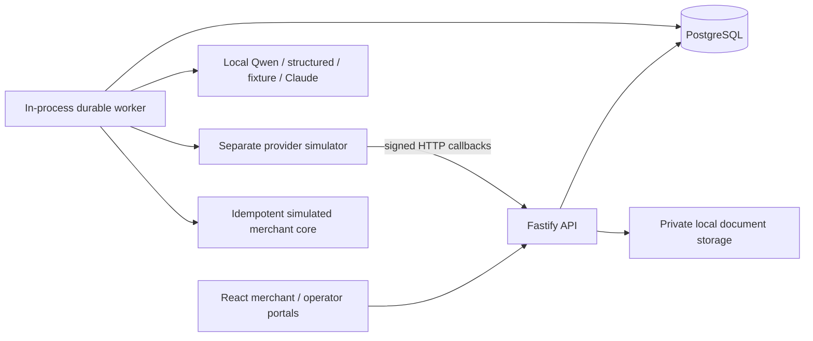

# Onboard — Autonomous Merchant Onboarding

A runnable merchant portal, operator console and durable verification workflow implementing the supplied [48-hour technical plan](docs/source-plan.txt). Built with React, TypeScript, Fastify and PostgreSQL. All demonstration information is synthetic.

## Run locally

On this Windows machine, double-click **`start.cmd`** (or run `.\start.cmd` in PowerShell). It starts the persistent database, local Qwen model, API/worker, provider simulator and website in the background, checks that they are ready, and prints **http://localhost:5173**. Run **`stop.cmd`** to stop the full stack, including the model and database. Existing applications and uploads are preserved. Logs are saved to `.local/hosting.log` and `.local/hosting-error.log`. Startup can take several minutes while the model loads; do not launch it twice.

For a fresh checkout, install dependencies and the model first. The foreground developer command remains available:

```powershell
npm install
npm run ai:setup
npm run dev
```

Open **http://localhost:5173**. The API runs at `http://127.0.0.1:3001`, and the separate provider simulator at `http://127.0.0.1:3002`. The launcher creates `.env` with independent random secrets on first run, starts local PostgreSQL on port 54329, applies migrations, starts the services and creates the demo login accounts. Applications start empty by default; set `AUTO_SEED_DEMO=true` or run `npm run seed` to load the demonstration cases. Existing application data is preserved. Keep the launcher running.

The project installs a local Node 22 runtime for npm scripts. Native PostgreSQL support is provided for Windows without Docker. Docker users can use the supplied `compose.yaml`; configure `DATABASE_URL` accordingly. Do not run two database servers on the same port.

| Role                                  | Email                   | Password       |
| ------------------------------------- | ----------------------- | -------------- |
| Merchant                              | `merchant@onboard.demo` | `DemoPass123!` |
| Operator                              | `operator@onboard.demo` | `DemoPass123!` |
| Second merchant, for ownership checks | `other@onboard.demo`    | `DemoPass123!` |

These credentials are for the local synthetic demo. The login screen provides merchant and operator presets. To start with fresh structured evidence, choose **New application → Fill synthetic sample** and continue through the wizard.

## Commands

| Command                           | Purpose                                                                                                 |
| --------------------------------- | ------------------------------------------------------------------------------------------------------- |
| `npm run dev`                     | Database, migrations, users, API/worker, simulator, frontend and seed verification                      |
| `npm run demo:reset`              | While dev is running: stop child services, erase demo data, restart and reseed; sign in again afterward |
| `npm run db:local`                | Start only the persistent local PostgreSQL instance                                                     |
| `npm run db:migrate`              | Apply SQL migrations to the configured running database                                                 |
| `npm run seed`                    | Seed users and applications; existing data is preserved                                                 |
| `npm run ai:setup`                | Download and checksum-verify the open model and Windows runtime                                         |
| `npm run ai:start`                | Start the local Qwen vision server independently                                                        |
| `npm run verify:ai`               | Test fresh PDFs and images against the actual local model                                               |
| `npm run fixtures`                | Regenerate nine synthetic PDFs, hash mappings, matching form and public downloads                       |
| `npm run typecheck`               | Strict TypeScript check                                                                                 |
| `npm test`                        | Unit and real-PostgreSQL integration tests                                                              |
| `npm run build`                   | TypeScript check and production frontend build                                                          |
| `npm run check`                   | TypeScript, unit/integration tests and production build                                                 |
| `npx playwright install chromium` | Install the browser used by end-to-end tests                                                            |
| `npm run test:e2e`                | Full-stack merchant/operator browser journeys, desktop/mobile checks and videos                         |
| `npm run verify:restart`          | Interrupt the API during verification and assert recovery to one merchant ID                            |
| `npm run format:check`            | Check formatting                                                                                        |

Vitest uses a **separate `onboard_test` database**, never the demo database. The PostgreSQL user must be able to create that test database, or it must already exist. Playwright adds synthetic applications to the running demo without resetting existing data. CI provisions PostgreSQL 16 and runs both suites. `dist/web` is the production SPA build; the local launcher uses Vite.

## Testing PDF uploads

Choose **New application → Use PDF sample details** to fill the form matching the downloadable PAN, GST and bank PDFs. Upload each file in its corresponding slot. See [sample files and instructions](fixtures/README.md) and [matching form JSON](fixtures/sample-application.json). The separate **Fill synthetic sample** button generates fresh structured evidence with different identifiers. Reusing the fixed PDF identifiers can correctly trigger duplicate review.

The classifier supports `PAN_CARD`, `GST_CERTIFICATE`, `BANK_PROOF`, `OTHER` (readable unrelated content) and `UNKNOWN` (unidentifiable content). `OTHER`, `UNKNOWN` and wrong-slot documents block verification through `V-DOC-TYPE` and require replacement. Upload slots remain restricted to PAN, GST and bank evidence.

Overview shows each document's processing result and why checks are blocked. Extraction failures show **Failed** immediately, with retry or recovery guidance. Successful extractions are retained; retries process only the failed documents. Rejected classifications show **Needs Info**. These checks assess document suitability, not authenticity.

## Extraction modes and LLM

The default is **`EXTRACTOR=local`**, using **Qwen3-VL-2B-Instruct** through a local llama.cpp server. No Anthropic/OpenAI account or API key is needed. `npm run ai:setup` installs pinned, checksum-verified weights and a Windows Vulkan runtime under `%LOCALAPPDATA%\OnboardAI`. The dev launcher starts the reader if it is not already running. PDFs are rendered into images and the model reads their actual contents; uploaded files do not need a fixture mapping. PDFs are limited to three pages per upload.

The wizard shows the active reader and availability. The Fields & documents tab records which model extracted each document. Long calls renew the durable job lease, and failed model calls never silently switch to fixture answers. See [model research, setup and limits](docs/model-research.md).

`EXTRACTOR=fixture` remains an explicit offline testing mode. It reads SHA-256 mappings for the supplied samples only; unregistered or modified files fail extraction in that mode. Vitest and CI use this mode for repeatability. Structured demo evidence uses entered fields directly.

To optionally use hosted Claude, configure `.env` and restart the API:

```dotenv
EXTRACTOR=llm
ANTHROPIC_API_KEY=your-key
EXTRACTION_MODEL=claude-opus-5-5
```

The optional Anthropic adapter is configured for **Claude Opus 5.5 (`claude-opus-5-5`)**; it is inactive in local mode. It uses the official SDK, image/PDF content blocks, forced structured tool output, a 30-second request timeout and one SDK retry. The model classifies actual content independently of the upload slot, then transcribes supported fields. Outputs are schema-validated before deterministic rules run. Document content is treated as untrusted data. The model never approves applications or overwrites declared form values.

Live paid extraction requires credentials and is not covered by offline test results. Fixtures are authored synthetic ground truth, not recordings of live model responses. See the official [Anthropic model documentation](https://platform.claude.com/docs/en/models/overview) and [tool definitions](https://platform.claude.com/docs/en/agents-and-tools/tool-use/define-tools) for API contracts.

## Implemented behavior

- Ten explicit application states and guarded transitions. Approval and merchant provisioning are separate.
- PostgreSQL row locking per application. State transitions, audit entries and follow-up jobs commit together.
- Durable job queue with `FOR UPDATE SKIP LOCKED`, exponential backoff/jitter, bounded retries, lease reclamation and lease-token fencing.
- Separate simulated PAN, GST, bank and risk checks. Risk waits for the other three checks. Policies are database-managed.
- HMAC-SHA256 callbacks verified over the original request bytes, a five-minute timestamp window, unique provider/event inbox keys and attempt compare-and-set.
- Duplicate, late, stale, already-completed and unmatched callbacks are retained and visible. Simulator request and delivery records are durable.
- Input-hash-bound results. Bank changes invalidate BANK and RISK while unchanged PAN/GST results remain valid. Approved data is immutable.
- PDF/PNG/JPEG magic-byte validation, a 5 MB limit, local Qwen, fixture or Claude extraction, field confidence and deterministic reconciliation.
- Required fields, identifier formats, GSTIN checksum, PAN/GST cross-reference, name consistency and exact duplicate detection.
- Information requests, merchant corrections, exception resolution, review decisions, check reruns, extraction reprocessing and provisioning recovery.
- Operator list/search/filter, review queue, field comparison, attempt/callback history, timeline, metrics, dead letters and simulator controls.
- JWT role/ownership enforcement, bcrypt passwords, AES-256-GCM encrypted forms and extracted values, HMAC blind indexes, masked JSON and append-only audit triggers.
- Application creation and merchant provisioning idempotency, backed by database uniqueness constraints.

## Demonstrating the six failures

| Scenario              | Seed / action                              | Expected evidence                                                         |
| --------------------- | ------------------------------------------ | ------------------------------------------------------------------------- |
| PAN passes, GST fails | Malabar Spice Traders LLP                  | Failed GST, blocked risk and no approval; request correction or rerun GST |
| Duplicate callbacks   | Nilgiri Tea Estates Private Limited        | Three BANK deliveries, one applied event                                  |
| Late callback         | Konkan Marine Supplies                     | PAN timeout, successful retry and ignored late original callback          |
| Bank changes          | Aravalli Stone Works, merchant bank change | New BANK/RISK cycles with PAN/GST preserved                               |
| Unreadable document   | Deccan Home Foods                          | Specific PAN replacement request, no provider checks dispatched           |
| Provisioning outage   | Sahyadri, operator retry provisioning      | Approval preserved, eventual activation and one merchant ID               |

See the [demo walkthrough](docs/demo.md) for the presentation sequence. The seed verifies 17 applications against their expected states. Reset is explicitly destructive to demo data; it is not needed for normal startup or testing a new application.

## Architecture and implementation choices



`apps/api` contains routes, application services, workflow, validation, extraction, provider adapters and queue handlers. `apps/mock-providers` contains the separate HTTP simulator. `apps/web` contains the portals. `packages/shared` owns runtime schemas, state tables, validators and synthetic data factories.

Deliberate adjustments to the supplied plan:

- Parameterized SQL through `pg` replaces Drizzle, keeping locks, compare-and-set and transactions visible. Migrations are versioned SQL.
- The form is encrypted as one JSON value, with searchable legal names and identifier blind indexes stored separately. Structured evidence and extracted values are encrypted.
- Custom CSS and native form controls replace Tailwind/shadcn/react-hook-form. Shared Zod validation and TanStack Query handle validation and polling.
- Optional native PostgreSQL enables real database testing on Windows without Docker. Docker Compose remains supported.
- Simulator request/delivery records use the same PostgreSQL instance, while the simulator remains a separate HTTP service.
- Risk input hashes include the account holder. Score thresholds are LOW below 30, MEDIUM 30–69 and HIGH 70 or above; inconsistent score/band callbacks are rejected.
- Policies are database-managed; the UI does not expose arbitrary policy editing.

## Assumptions, mocks and limits

This is an **Indian-context, synthetic-data prototype** with three required evidence slots. All four checks are required by default. GST plus duplicate detection covers business checks. Payment capabilities are simulated. Operators can resolve judgement exceptions but cannot waive failed required checks. Bank details lock at approval. Notifications stay in the portal; deployment is local.

PAN/GST/bank/risk providers, risk scoring, merchant core and capability configuration are simulated. State transitions, jobs, signatures, validation, authorization, encryption, audit, human review, duplicate detection, metrics and browser flows run for real.

The demo assumes one API worker process. Concurrent claims and callback/timeout races are tested; production-scale load is not. Local document files are permission-restricted but unencrypted. Authenticated original-document viewing intentionally exposes the submitted evidence and is audited. JSON detail, structured-document views and audit responses mask identifiers. There is no anonymous uploaded-document URL or full-identifier reveal endpoint. Public sample downloads contain only fabricated data.

Production would need managed keys/rotation, durable encrypted object storage, malware scanning, SSO/MFA, stronger session lifecycle, tenant isolation, retention policies, monitoring, circuit breakers and actual provider contracts. Exact duplicate detection is implemented; fuzzy matching, SSE, review assignment, dead-letter replay and post-approval change workflows remain outside this implementation. Model confidence is not calibrated. One user-supplied PAN was checked locally for extraction and reconciliation; this does not establish document authenticity or general extraction accuracy.

Run `npm run test:stress` for isolated HTTP concurrency and browser regression tests, and `npm run test:stress:ai` for six concurrent callers of the running local model. The HTTP suite creates a separate database and document directory; it does not reset your applications. See [stress-test results and reproduction steps](docs/stress-testing.md).

See [verification results](docs/verification.md), [the walkthrough](docs/demo.md), and [the supplied source plan](docs/source-plan.txt).
