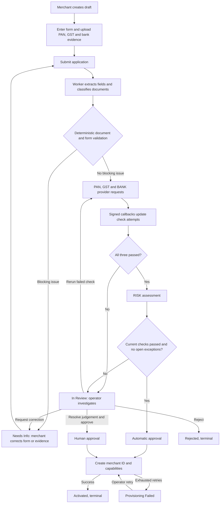
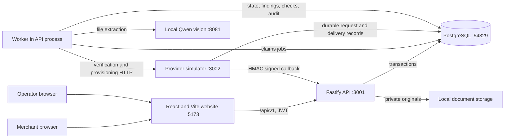
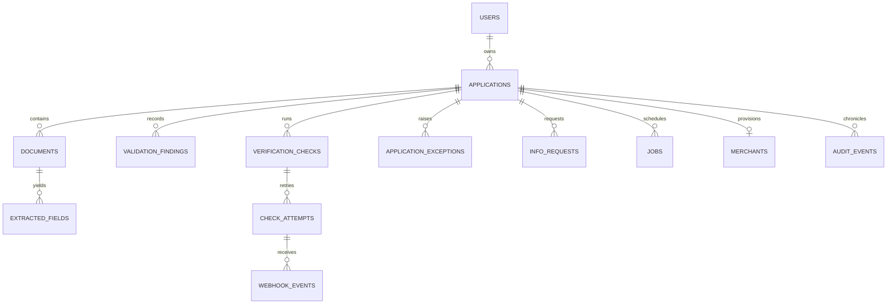

# Merchant onboarding: complete workflow and system design

This guide explains the running application from a merchant's first form to an
activated merchant ID. It describes the implementation in this repository as of
21 November 2026. For a presentation script, see [demo.md](demo.md); for the
operator's failure controls, see [provider-simulator.md](provider-simulator.md).

## What the system does

A merchant submits business details and three pieces of evidence: a PAN card,
GST certificate and bank proof. The system reads each document, compares it
with the form, calls four simulated verification services, and either approves
the application automatically or sends it to an operator. After approval, it
creates one simulated merchant ID with payment capabilities.

The **processing workflow is real**: uploads, extraction, validation, database
transactions, jobs, HTTP requests, signed callbacks, retries, review and audit
history all run. The PAN, GST, bank, risk and merchant provisioning endpoints
are **simulated**. A simulated pass does not prove that an identifier is
registered with a government or bank, or that a document is authentic.

## People and screens

| Role     | Screens and actions                                                                                                                                                                                                                                                                                                    |
| -------- | ---------------------------------------------------------------------------------------------------------------------------------------------------------------------------------------------------------------------------------------------------------------------------------------------------------------------- |
| Merchant | Sign in, view only their applications, create or edit a draft, upload evidence, submit, read findings and checks, answer information requests, replace documents, and change bank details before approval.                                                                                                             |
| Operator | Search applications, use the review queue, inspect evidence and attempts, resolve judgement exceptions, request corrections, rerun failed checks, reprocess failed extraction, approve or reject, retry provisioning, inspect metrics and dead letters, and configure the [provider simulator](provider-simulator.md). |

Both roles see the same application record. Each application detail page shows
an Overview, Fields & documents, Checks, and Timeline. The merchant sees masked
PAN, GSTIN and bank account values in API details. Operators can inspect
authorized original evidence; each view is audited. The website polls the API
while work is in progress, so status changes appear without a manual reload.

## The normal journey



1. **Create a draft.** The form contains the legal name, business details,
   contact information, PAN, GSTIN and bank details. A request key makes a
   repeated create request return the same application. A second application
   for the same merchant and registration is directed to the existing one.
2. **Attach evidence.** Each slot accepts PDF, PNG or JPEG, up to 5 MB. The
   active document for a slot can be replaced while the application is a draft
   or needs information. Identical repeated uploads reuse the active document
   record. The synthetic structured-evidence option is a demo shortcut and does
   not exercise OCR.
3. **Submit.** Submission increments the application's input version and
   creates an `INTAKE` job in the same database transaction. The HTTP response
   is immediate; processing continues in the worker.
4. **Extract.** For real files, the default local Qwen vision model reads the
   contents. A PDF is rendered to images, up to three pages. The model reports
   detected type, legibility, values and confidence. `OTHER` means readable but
   unrelated content; `UNKNOWN` means the type could not be identified. The
   requested upload slot does not determine the detected type. Results are
   schema checked, then saved. Already completed documents are reused on a
   retry; a failed document is retried.
5. **Validate.** Code checks required information, identifier formats,
   GSTIN checksum, PAN inside the GSTIN, expected document type, legibility,
   extracted identifiers versus form values, and name consistency. Exact
   identifier matches against other applications create a review exception.
   An unreadable, unrelated or wrong-slot file blocks provider dispatch and
   produces a specific correction request.
6. **Verify.** When validation has no blocking finding, the worker sends PAN,
   GST and BANK requests to separate simulator endpoints. Each service first
   acknowledges the request with a provider request ID, then sends a signed
   callback. RISK is dispatched only after the first three checks pass. The
   policy table controls which checks are enabled/required, dependencies,
   timeout and maximum attempts.
7. **Decide.** If all required current checks passed and no exception remains
   open, the application is approved automatically. Otherwise an operator can
   investigate, resolve a judgement exception, request corrections, rerun a
   failed check, approve when the guard permits it, or reject. A failed
   required check cannot be waived by resolving an exception.
8. **Provision.** Approval enqueues a merchant-core request. A successful
   response creates one merchant ID and capabilities (`UPI`, `CARDS`,
   `NETBANKING`). An exhausted outage moves the application to Provisioning
   Failed, where the operator can retry without losing approval.

## Four different kinds of result

These are deliberately separate. The UI combines them for a clear current
status while retaining the historical result.

| Layer                    | What it answers                                         | Example                                                                                                      |
| ------------------------ | ------------------------------------------------------- | ------------------------------------------------------------------------------------------------------------ |
| Extraction               | What does the uploaded file appear to contain?          | The GST slot contains a GST certificate; legal name was read with 0.92 confidence.                           |
| Deterministic validation | Does that evidence fit the form and basic format rules? | GSTIN checksum passes, but the certificate name differs from the form, so review is required.                |
| Provider check           | What did the simulated external service return?         | GST API returned `VERIFIED`, so the raw GST check is `PASSED`.                                               |
| Decision                 | May this application be approved now?                   | No: the name exception is still open; GST is shown **In Review**, and only three of four checks are cleared. |

**Provider passed** counts current successful API results. **Cleared** counts
checks whose provider result passed and whose associated evidence has no
outstanding issue. A reviewer accepting the name exception clears the displayed
GST evidence and check, but the application remains In Review until an operator
approves it. A later correction creates new findings; an older resolution does
not silently approve them. The original provider and validation history remains
visible.

### What each provider receives

| Check | Submitted subject                                       | Simulated response and local decision                                                                                                                         |
| ----- | ------------------------------------------------------- | ------------------------------------------------------------------------------------------------------------------------------------------------------------- |
| PAN   | Declared PAN and legal name                             | `VERIFIED` or `NOT_VERIFIED`; PAN document and form reconciliation already happened before dispatch.                                                          |
| GST   | Declared GSTIN and legal name                           | `VERIFIED` or `NOT_VERIFIED`; document name and GSTIN format/cross-reference are separate validation findings.                                                |
| BANK  | Account number, IFSC and holder name                    | `VERIFIED` or `NOT_VERIFIED`; the bank-proof fields are reconciled separately.                                                                                |
| RISK  | PAN, GSTIN, bank details, business category and pincode | Score 0–100 with LOW, MEDIUM or HIGH band. LOW passes, MEDIUM passes with a review exception, HIGH fails. The API rejects a band inconsistent with its score. |

The simulator normally returns success. It does not contact a registry, bank
or actual risk bureau, and its default response is not calculated from the
submitted subject values. Its failure scenarios are described in
[provider-simulator.md](provider-simulator.md).

## Application states and corrections

| State                 | Meaning                                                                 | Main next action                                                     |
| --------------------- | ----------------------------------------------------------------------- | -------------------------------------------------------------------- |
| `DRAFT`               | Form/evidence is being prepared.                                        | Merchant edits, uploads and submits.                                 |
| `SUBMITTED`           | Submission was accepted; intake is queued.                              | Worker starts extraction.                                            |
| `EXTRACTING`          | Documents are being read and validated.                                 | Worker completes intake, retries a failed read, or raises a failure. |
| `NEEDS_INFO`          | Blocking validation or an operator request needs a merchant correction. | Merchant edits/replaces evidence and resubmits.                      |
| `VERIFYING`           | Provider checks are queued, awaiting callbacks, or being evaluated.     | Callbacks, timeouts and dependencies advance the checks.             |
| `IN_REVIEW`           | A human must decide or recover an issue.                                | Operator resolves, requests info, reruns, approves or rejects.       |
| `APPROVED`            | Decision is final; merchant ID creation is pending.                     | Provisioning job runs.                                               |
| `PROVISIONING_FAILED` | Approval stands, but the core request exhausted retries.                | Operator retries provisioning.                                       |
| `ACTIVATED`           | Merchant ID and capabilities exist.                                     | Terminal in this demo.                                               |
| `REJECTED`            | Operator rejected the application with a reason.                        | Terminal; create a new application if needed.                        |

The transition rules live in `packages/shared/src/index.ts`. API actions are
also guarded by role and current state, so a stale browser cannot submit or
approve after the application has moved on.

For a correction, the merchant changes the requested form fields or replaces
the evidence in `NEEDS_INFO`, then resubmits. The new input version gets fresh
validation findings. Checks are tied to a hash of the fields they use; a
changed bank account or holder invalidates BANK and RISK while unchanged PAN
and GST results remain current. During `VERIFYING` or `IN_REVIEW`, a dedicated
bank-change action accepts the complete new bank account and optional proof.
Bank details are locked after approval.

On rejection, open exceptions are closed, open information requests are
cancelled and pending attempts are superseded. A document explicitly selected
as the reason for `INVALID_DOCUMENTS` displays **Invalid**. Other unresolved
document reviews display **Rejected**, and unfinished work displays
**Cancelled**. Historical provider passes remain identifiable as past results.

## Components and data flow



The website uses React, TypeScript, TanStack Query and polling. Vite proxies
`/api` to Fastify during local development. The API authenticates requests,
validates payloads, performs state changes, and serves a consistent application
snapshot. The worker runs in the API process but claims work from PostgreSQL,
so jobs survive an API restart. The simulator is a separate HTTP service with
its own persisted request and callback-delivery records in the same database.

The default file reader is Qwen3-VL-2B-Instruct through a local llama.cpp
server. `EXTRACTOR=fixture` is for repeatable sample tests, and `EXTRACTOR=llm`
is an optional Claude adapter. Only the file-reading component changes;
validation, provider flow and decisions remain the same. See
[model-research.md](model-research.md).

### Main API interactions

The website calls these routes under `/api/v1`. The API validates each request
and applies the role/state rules above.

| Interaction                    | API route                                                                                                          | Effect                                                                      |
| ------------------------------ | ------------------------------------------------------------------------------------------------------------------ | --------------------------------------------------------------------------- |
| Sign in                        | `POST /auth/login`                                                                                                 | Returns a short-lived JWT and role.                                         |
| List or inspect                | `GET /applications`, `GET /applications/:id`                                                                       | Returns owned applications to merchants and the operator view to operators. |
| Draft and evidence             | `POST /applications`, `PATCH /applications/:id`, `POST /applications/:id/documents`                                | Saves the form and active documents.                                        |
| Submit correction or new draft | `POST /applications/:id/submit`                                                                                    | Commits the input version and queues intake.                                |
| Change bank details            | `PUT /applications/:id/bank-account`                                                                               | Saves a complete bank account, optional proof, and queues reprocessing.     |
| Decide or request help         | `POST /applications/:id/approve`, `/reject`, `/request-info`                                                       | Operator decisions and correction requests.                                 |
| Recover                        | `POST /applications/:id/checks/:checkType/rerun`, `/exceptions/:exId/resolve`, `/reprocess`, `/provisioning/retry` | Operator review and recovery actions.                                       |
| Inspect operations             | `GET /review-queue`, `/metrics/summary`, `/dead-letters`                                                           | Queue, metrics and exhausted-work views.                                    |
| Configure demo                 | `GET`, `PUT`, `DELETE /simulator/scenarios`                                                                        | Operator-only future provider rules in demo mode.                           |

The provider callback endpoint is `/api/v1/webhooks/providers/:provider`. It
uses the signed raw body instead of a merchant or operator JWT. The website
does not call this endpoint.

### A check request and callback

```mermaid
sequenceDiagram
  participant Job as Durable worker
  participant DB as PostgreSQL
  participant Sim as Provider simulator
  participant API as Fastify callback endpoint
  Job->>DB: Claim DISPATCH_CHECK with lease token
  Job->>Sim: POST verify/assess with attempt ID as idempotency key
  Sim->>DB: Save request and scheduled callback
  Sim-->>Job: HTTP 202 + provider request ID
  Job->>DB: Mark attempt awaiting callback; schedule timeout
  Sim->>API: POST callback + timestamp + HMAC signature
  API->>API: Verify raw body, timestamp, provider and request ID
  API->>DB: Insert event; lock application; compare attempt and input hash
  API->>DB: Apply once, audit, evaluate dependencies and approval guard
  API-->>Sim: Outcome
```

An unusually early callback may arrive before the dispatch acknowledgement;
the attempt can still be completed. Once the acknowledgement is stored, its
provider request ID must match the callback. Duplicate event deliveries are
counted but do not reapply the result. Late, stale, already completed and
unmatched callbacks are retained with an outcome for investigation. A timeout
can create another attempt up to the policy limit; old callbacks cannot replace
a later result.

## Durable data and responsibilities



| Data                                                           | Purpose                                                                           |
| -------------------------------------------------------------- | --------------------------------------------------------------------------------- |
| `users`, `applications`                                        | Identity, ownership, encrypted form, current state and input version.             |
| `documents`, `extracted_fields`, `validation_findings`         | Active and historical evidence, transcribed values, confidence and rule results.  |
| `verification_checks`, `check_attempts`, `check_policies`      | Current result per check, every attempt, dependencies, timeouts and retry limits. |
| `webhook_events`, `mock_requests`, `mock_scenarios`            | Callback inbox, simulated provider requests/deliveries and future-response rules. |
| `application_exceptions`, `info_requests`, `duplicate_matches` | Reviewer issues, merchant correction requests and exact identifier matches.       |
| `jobs`, `merchants`, `audit_events`                            | Background work, one provisioned merchant and append-only history.                |

An application row is locked while changing its workflow state. State changes,
new jobs and audit events commit together. Workers claim available jobs with
`FOR UPDATE SKIP LOCKED`, renew a lease during long model calls, use a lease
token to reject stale workers, and retry with bounded backoff. A job that
exhausts retries appears in **Dead letters**. Provisioning is idempotent both
at the simulator and in the database, so retrying cannot create a second
merchant ID. The local demo runs one API worker process; multiple API replicas
and production-scale throughput are outside its tested setup.

## Security and privacy boundaries

- JWTs identify the role; the API reloads the user from the database for each
  request. Merchants can read only their own applications; operator actions
  require the operator role.
- Forms, structured evidence and extracted values are encrypted in PostgreSQL
  with AES-256-GCM. Searchable identifier comparisons use keyed blind indexes.
  Original file uploads are stored privately on disk, with access through an
  authenticated and audited endpoint. The originals are not encrypted on disk.
- Callback signatures use a provider-specific HMAC over the raw request body
  and timestamp. The accepted timestamp window is five minutes.
- JSON details mask PAN, GSTIN and account numbers. Notes and audit payloads
  are sanitized. Audit rows cannot be updated or deleted by normal application
  code because the database has an append-only trigger.
- The simulator controls require an operator account and demo mode. The
  simulator's internal endpoints require a separate secret.

This is a local demonstration system. Real external provider contracts,
document authenticity checks, malware scanning, managed key rotation,
encrypted object storage and production access controls would be needed before
using it for real merchant onboarding.

## Where to inspect the implementation

| Concern                                    | Source                                                                                              |
| ------------------------------------------ | --------------------------------------------------------------------------------------------------- |
| Website and routes                         | `apps/web/src/main.tsx`, `apps/web/src/api.ts`                                                      |
| API, authentication and callback endpoint  | `apps/api/src/server.ts`                                                                            |
| Form/document storage and operator actions | `apps/api/src/applications.ts`                                                                      |
| Intake, checks, decisions and callbacks    | `apps/api/src/workflow.ts`                                                                          |
| Document rules and status presentation     | `apps/api/src/validation.ts`, `apps/api/src/presentation.ts`                                        |
| Durable worker and retries                 | `apps/api/src/jobs.ts`                                                                              |
| Extractors and PDF rendering               | `apps/api/src/extraction.ts`, `apps/api/src/local-extraction.ts`, `apps/api/src/document-images.ts` |
| Simulated providers                        | `apps/mock-providers/src/server.ts`, `apps/api/src/providers.ts`                                    |
| Shared state and input schemas             | `packages/shared/src/index.ts`                                                                      |
| Database schema and migrations             | `apps/api/migrations/`                                                                              |

Start the stack with `start.cmd` and open `http://localhost:5173`. The demo
logins and sample document instructions are in the [README](../README.md) and
[fixtures guide](../fixtures/README.md). Tests and measured limits are recorded
in [verification.md](verification.md) and [edge-case-audit.md](edge-case-audit.md).
